# Manual Book Appnea

Panduan lengkap memakai Appnea — platform sekolah freediving: katalog kursus,
jadwal, booking, dan panel admin.

Dokumen ini dibagi tiga bagian sesuai siapa yang memakainya:

1. **Pengunjung** — orang yang browsing website, belum tentu punya akun
2. **Murid** — orang yang sudah daftar dan mau booking kursus
3. **Admin** — tim Appnea yang mengelola isi website dan booking

Kalau kamu mencari cara **menyiapkan environment** dan menjalankan aplikasinya,
itu ada di `WHAT_NEEDED.md`, bukan di sini.

---

## Alamat penting

| Untuk siapa | Alamat |
|---|---|
| Pengunjung dan murid | http://localhost:5173 |
| Admin | http://localhost:3000/admin/login |

Akun bawaan dari data contoh, keduanya berpassword `changeme123`:

| Email | Peran |
|---|---|
| `admin@appnea.test` | Admin, bisa masuk panel admin |
| `student@appnea.test` | Murid biasa, bisa booking |

---

# Bagian 1 — Untuk Pengunjung

## 1.1 Halaman depan

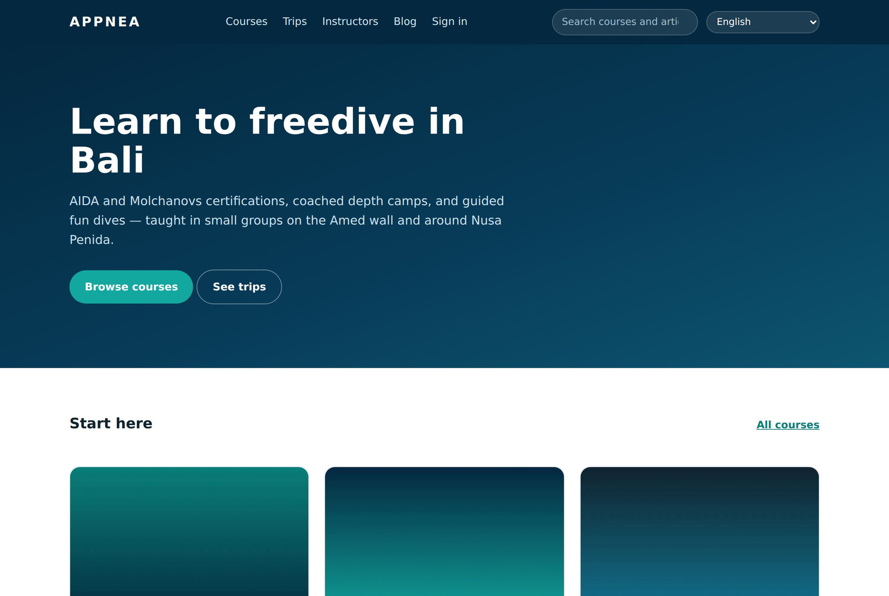

Halaman depan punya tiga bagian:

- **Hero** di atas, dengan dua tombol: *Browse courses* dan *See trips*
- **Start here** — tiga kursus pertama, diurutkan dari yang paling singkat
- **From the blog** — tiga artikel terbaru

Di header ada menu utama, kotak pencarian, dan pemilih bahasa. Header ini
menempel di atas, jadi tetap kelihatan waktu kamu scroll.

## 1.2 Mengganti bahasa

Dropdown di kanan atas mengganti bahasa antara **English** dan
**Bahasa Indonesia**.

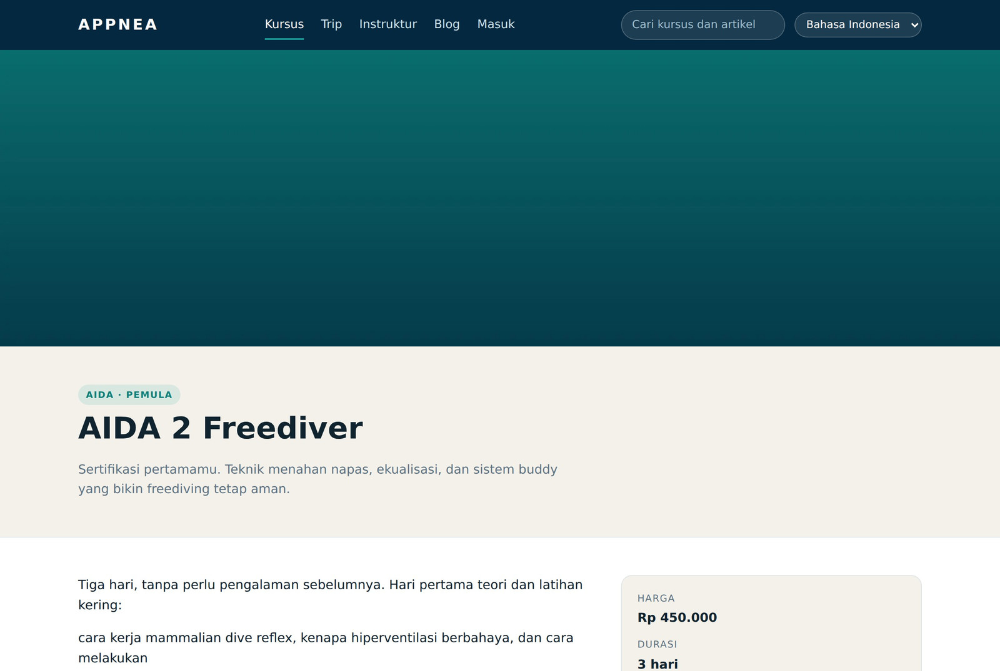

Yang perlu diketahui soal ini:

- Yang berganti bukan cuma menu dan tombol, tapi **isi kursus dan artikelnya
  juga** — judul, ringkasan, dan deskripsi punya versi Indonesia sendiri di
  database.
- Kalau ada bagian yang belum diterjemahkan, bagian itu **tetap tampil dalam
  bahasa Inggris**, bukan kosong. Jadi halaman selalu utuh walaupun
  terjemahannya baru setengah jalan.
- Pilihan bahasamu **diingat** lewat cookie. Kunjungan berikutnya langsung pakai
  bahasa yang sama.
- Kalau kamu belum pernah memilih, website menebak dari pengaturan bahasa
  browser kamu.

## 1.3 Melihat daftar kursus

Klik **Courses** di menu.

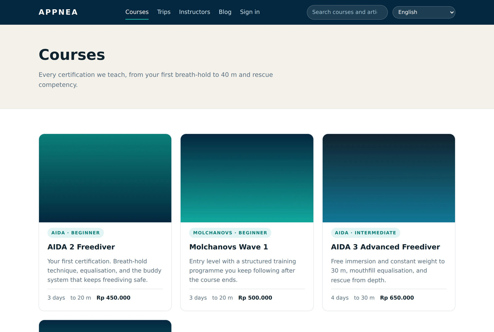

Tiap kartu menampilkan agensi sertifikasi (AIDA, SSI, atau Molchanovs), level,
judul, ringkasan singkat, durasi, target kedalaman, dan harga.

Kursus diurutkan dari durasi terpendek, jadi kursus pemula muncul lebih dulu.

## 1.4 Halaman detail kursus

Klik salah satu kartu kursus.

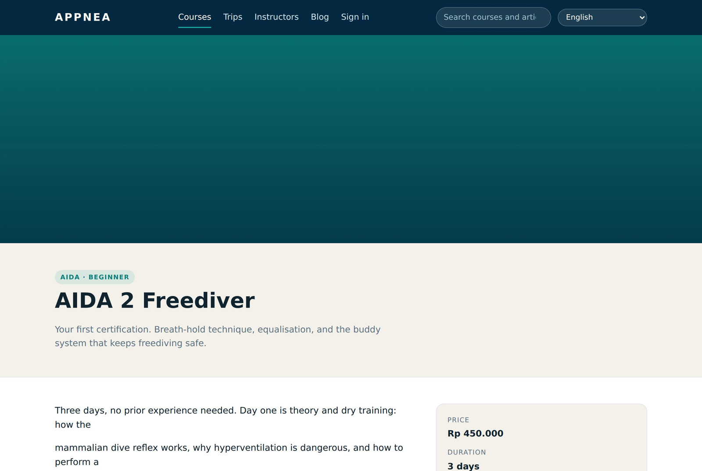

Di sini kamu dapat deskripsi lengkap, dan di kolom kanan ada ringkasan fakta:
harga, durasi, target kedalaman, dan agensi.

Scroll ke bawah untuk melihat jadwal.

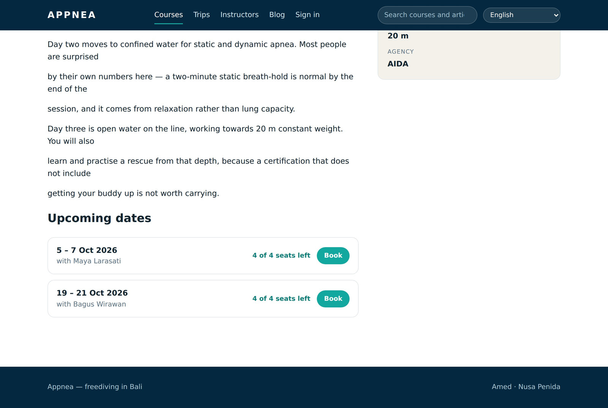

Tiap baris jadwal menampilkan:

- **Tanggal** mulai dan selesai
- **Instruktur** yang mengajar, atau "Instructor to be assigned" kalau belum
  ditentukan
- **Sisa kursi**, misalnya "3 of 4 seats left"
- Tombol **Book**

Angka sisa kursi berubah warna waktu tinggal sedikit, dan kalau sudah habis
tombol Book hilang, diganti tulisan **Fully booked**.

Hanya jadwal yang **akan datang** dan **masih dibuka** yang ditampilkan. Jadwal
yang sudah lewat atau dibatalkan tidak muncul sama sekali.

## 1.5 Mencari sesuatu

Ada kotak pencarian di header setiap halaman. Ketik lalu tekan Enter.

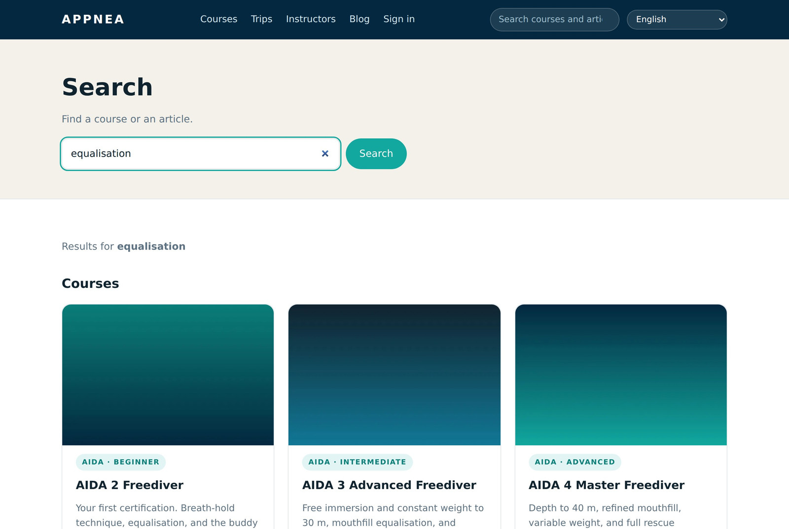

Pencarian menjangkau **kursus dan artikel sekaligus**, dan mencari sampai ke
dalam isi teksnya — bukan cuma judul. Jadi mencari "frenzel" akan menemukan
artikel yang membahasnya di paragraf tengah.

Beberapa hal yang bisa kamu lakukan:

| Ketik ini | Hasilnya |
|---|---|
| `equalisation` | Semua yang menyebut kata itu |
| `"free immersion"` | Frasa persis, dengan tanda kutip |
| `depth 40` | Yang mengandung kedua kata |
| `courses` | Juga menemukan "course" — pencarian mengerti bentuk jamak |

Hasil diurutkan berdasarkan relevansi: kecocokan di judul menang atas kecocokan
di isi tulisan.

> **Catatan:** pencarian saat ini paling optimal untuk teks berbahasa Inggris.
> Konten Indonesia tetap ketemu, tapi bentuk kata berimbuhan belum dikenali —
> "penyelam" tidak akan menemukan "menyelam".

## 1.6 Trip

Menu **Trips** berisi perjalanan menyelam dan depth camp, terpisah dari kursus
sertifikasi.

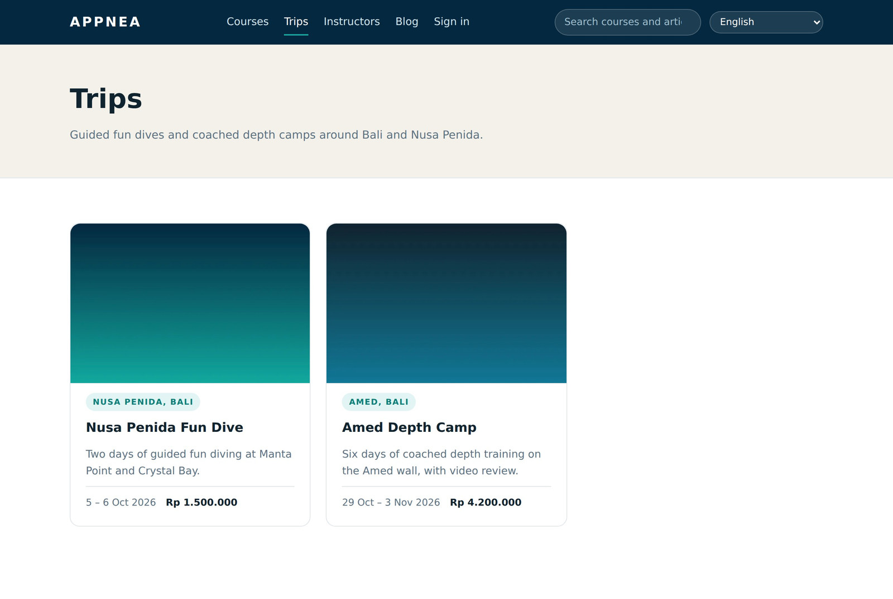

Bedanya dengan kursus: trip punya tanggal yang sudah tetap dan tujuan tertentu,
bukan jadwal yang berulang.

Trip belum bisa di-booking lewat website. Hubungi tim untuk mendaftar.

## 1.7 Instruktur

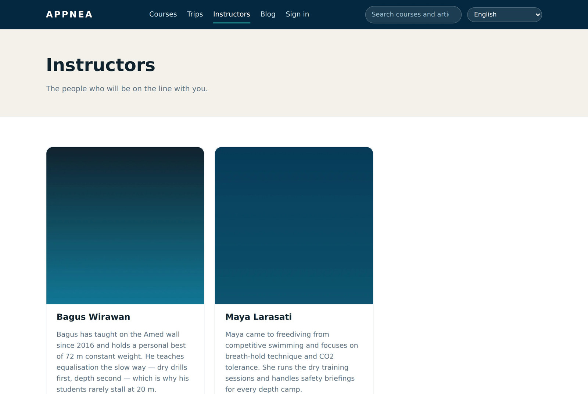

Profil tiap instruktur beserta sertifikasi yang mereka pegang. Urutannya diatur
dari panel admin.

## 1.8 Blog

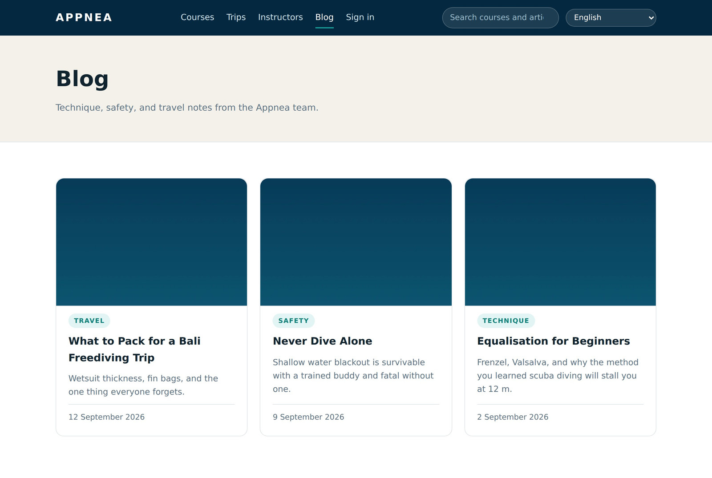

Artikel tentang teknik, keselamatan, dan tips perjalanan. Klik salah satu untuk
membacanya.

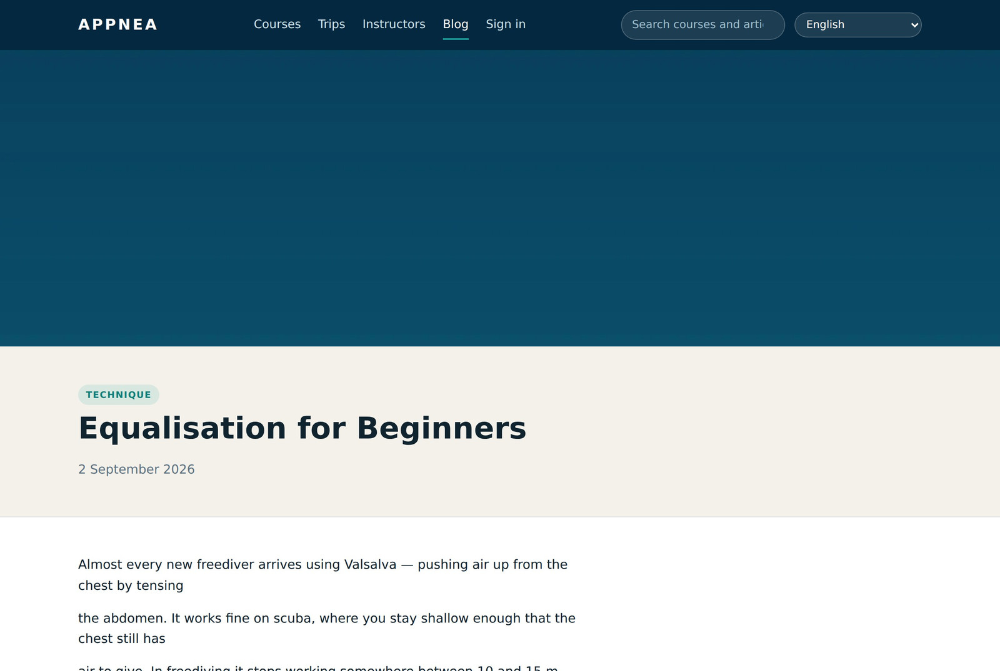

Artikel yang masih berstatus draf tidak muncul di daftar, dan **tidak bisa
dibuka walaupun kamu tahu alamatnya** — akan balas 404. Jadi tulisan yang belum
siap tidak akan bocor.

---

# Bagian 2 — Booking Kursus

## 2.1 Membuat akun

Booking butuh akun. Kalau kamu klik **Book** tanpa login, website otomatis
mengarahkanmu ke halaman masuk, dan setelah berhasil kamu **dikembalikan ke
halaman booking yang tadi** — tidak perlu mencari ulang.

Klik **Sign in** di menu, lalu **Create one**.

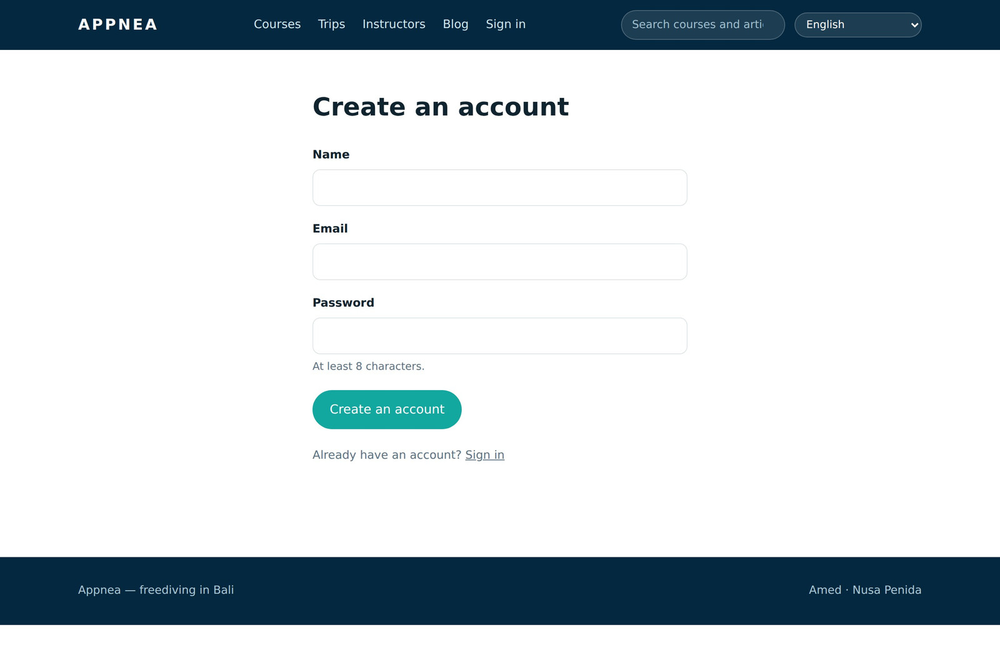

Isi nama, email, dan password. Password minimal 8 karakter.

Kalau sudah punya akun, langsung pakai halaman masuk.

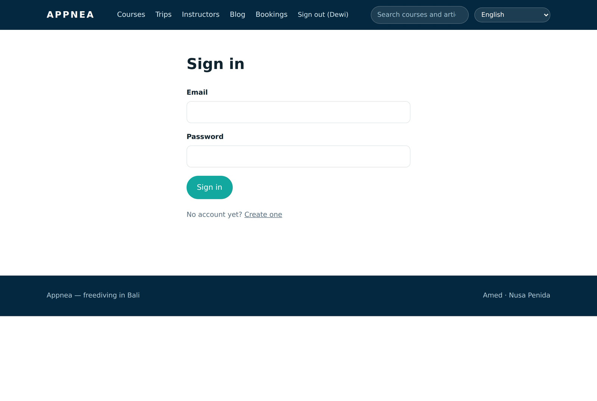

> **Soal keamanan:** kalau email atau password salah, pesannya sama persis untuk
> kedua kasus. Ini disengaja — supaya orang tidak bisa memakai form ini untuk
> menebak-nebak email mana yang terdaftar.

## 2.2 Halaman booking kamu

Setelah daftar, kamu diantar ke halaman **Bookings**.

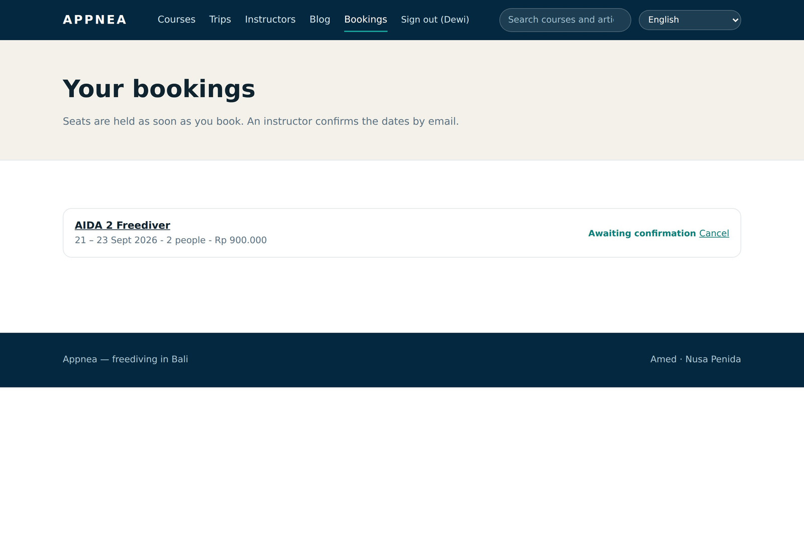

Awalnya kosong. Menu **Bookings** akan muncul di header selama kamu masih login.

## 2.3 Melakukan booking

Dari halaman detail kursus, klik **Book** pada jadwal yang kamu mau.

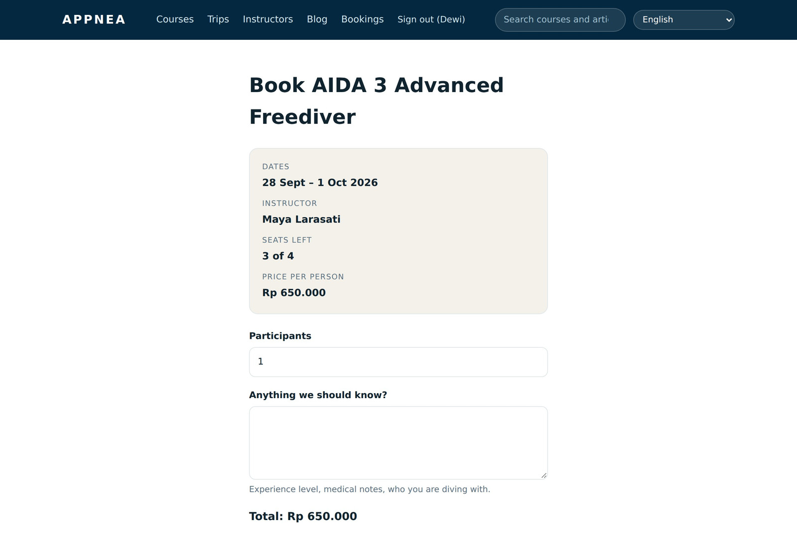

Bagian atas menampilkan ringkasan: tanggal, instruktur, sisa kursi, dan harga
per orang.

Isi jumlah peserta dan catatan kalau ada.

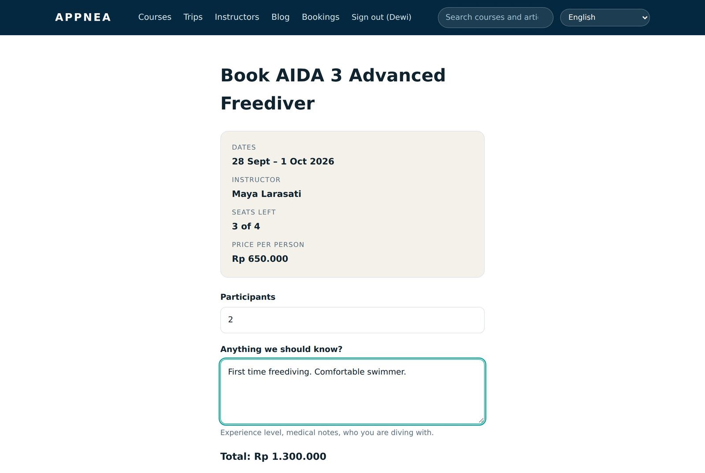

Total harga dihitung otomatis dan berubah begitu kamu mengganti jumlah peserta.

Kolom catatan gunanya untuk memberi tahu instruktur hal-hal yang perlu mereka
ketahui lebih dulu: level pengalaman, catatan medis, atau siapa yang menyelam
bersamamu.

Klik **Request booking**.

## 2.4 Setelah booking

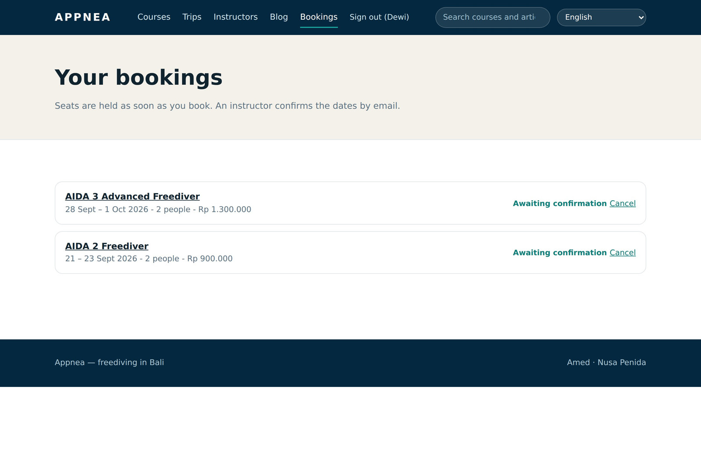

Booking kamu masuk dengan status **Awaiting confirmation**.

Yang terjadi di balik layar:

1. **Kursimu langsung ditahan.** Sisa kursi di jadwal itu berkurang saat itu
   juga, jadi tidak ada orang lain yang bisa mengambilnya sambil kamu menunggu.
2. **Email masuk ke kotak masukmu**, berisi rincian booking.
3. **Belum ada tagihan apa pun.** Pembayaran belum terpasang di sistem ini —
   tim akan menghubungimu.
4. **Instruktur mengonfirmasi lewat panel admin**, dan kamu dapat email kedua.

> **Kalau dua orang berebut kursi terakhir**, hanya satu yang berhasil. Yang
> kalah mendapat pesan yang jelas, misalnya "only 1 seat(s) left", dan kursinya
> tidak ikut terpotong. Ini diuji khusus, bukan kebetulan.

## 2.5 Membatalkan booking

Di halaman **Bookings**, klik **Cancel** di samping booking yang mau dibatalkan.

Statusnya berubah jadi **Cancelled**, dan **kursinya langsung kembali** ke
jadwal supaya orang lain bisa memakainya.

Kamu hanya bisa membatalkan booking milikmu sendiri.

## 2.6 Keluar

Klik **Sign out** di header. Nama depanmu tertulis di tombolnya.

---

# Bagian 3 — Untuk Admin

## 3.1 Masuk ke panel admin

Buka **http://localhost:3000/admin/login**

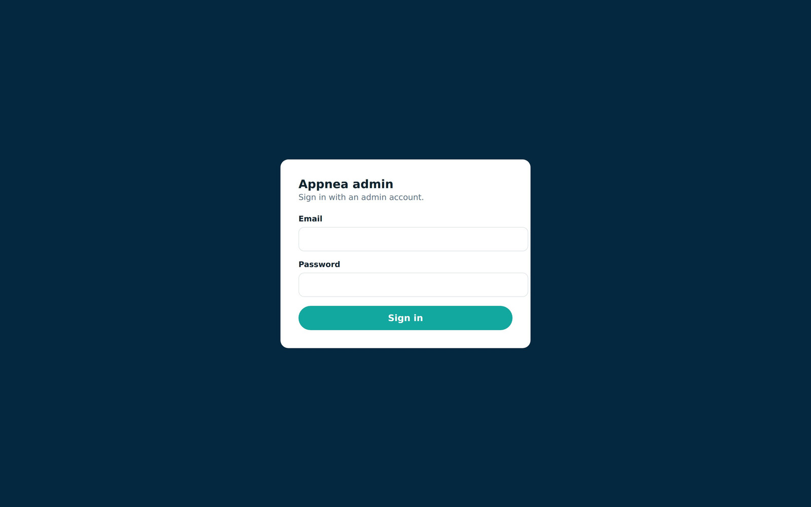

Hanya akun dengan peran **admin** yang bisa masuk. Akun murid dengan password
benar sekalipun tetap ditolak, dengan pesan yang sama persis seperti password
salah.

Panel admin **terpisah dari website publik**. Login di website tidak membuatmu
masuk ke panel admin, dan sebaliknya.

## 3.2 Tampilan panel

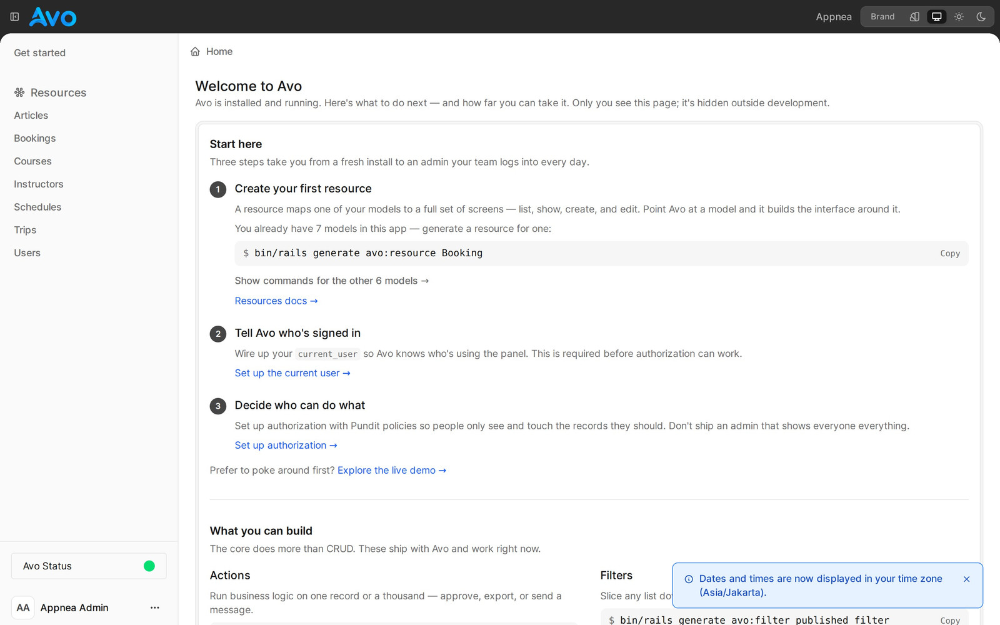

Menu di kiri berisi semua yang bisa dikelola: Article, Booking, Course,
Instructor, Schedule, Trip, dan User.

Tiap daftar bisa diurutkan, dicari, dan difilter.

## 3.3 Mengelola kursus

Klik **Course**, lalu salah satu kursus, lalu **Edit**.

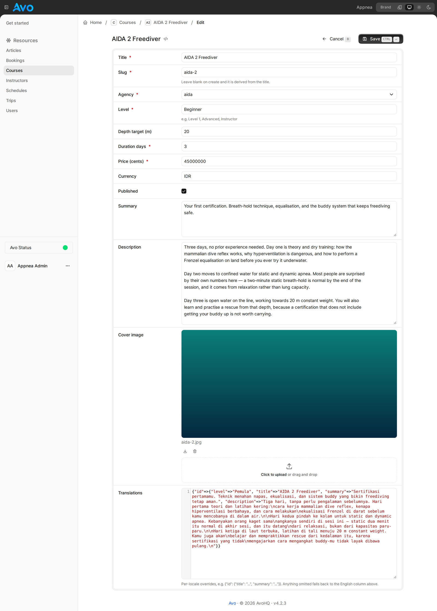

Kolom yang tersedia:

| Kolom | Keterangan |
|---|---|
| Title | Judul kursus |
| Slug | Bagian alamat website. Kosongkan saat membuat baru, akan dibuat otomatis dari judul |
| Agency | AIDA, SSI, atau Molchanovs |
| Level | Bebas diisi, misalnya Beginner atau Advanced |
| Depth target (m) | Target kedalaman, boleh dikosongkan |
| Duration days | Jumlah hari |
| Price (cents) | **Harga dalam sen.** Rp 450.000 ditulis `45000000` |
| Published | Kalau belum dicentang, kursus tidak muncul di website |
| Summary | Teks pendek untuk kartu di daftar kursus |
| Description | Teks panjang untuk halaman detail |
| Cover image | Gambar sampul |
| Translations | Terjemahan, lihat bagian berikutnya |

> **Harga ditulis dalam sen**, bukan rupiah. Ini supaya tidak ada pembulatan
> yang meleset saat menghitung total. Rp 450.000 berarti `45000000`.

> **Kursus yang belum dicentang Published tidak muncul di website sama sekali**
> — tidak di daftar, tidak lewat pencarian, dan alamatnya balas 404. Pakai ini
> untuk menyiapkan kursus baru sebelum diumumkan.

## 3.4 Mengisi terjemahan

Kolom **Translations** berisi teks berformat JSON. Bentuknya seperti ini:

```json
{
  "id": {
    "title": "AIDA 2 Penyelam Bebas",
    "level": "Pemula",
    "summary": "Sertifikasi pertamamu. Teknik menahan napas dan ekualisasi.",
    "description": "Tiga hari, tanpa perlu pengalaman sebelumnya..."
  }
}
```

Aturannya:

- `"id"` adalah kode bahasa Indonesia. Kolom bahasa Inggris yang di atas
  dipakai sebagai bahasa dasar.
- Kamu **tidak harus mengisi semuanya**. Kolom yang tidak ada di sini otomatis
  memakai versi Inggris.
- Kalau JSON-nya salah tulis, penyimpanan akan gagal. Perhatikan tanda kutip dan
  koma.

Kolom yang bisa diterjemahkan:

| Model | Kolom |
|---|---|
| Course | `title`, `level`, `summary`, `description` |
| Trip | `title`, `destination`, `summary`, `description` |
| Article | `title`, `excerpt`, `body` |

> **Profil instruktur belum bisa diterjemahkan.** Bio instruktur akan tetap
> tampil dalam bahasa aslinya walaupun pengunjung memilih Bahasa Indonesia.

## 3.5 Mengunggah gambar

Kolom **Cover image** ada di Course, Trip, dan Article. Instruktur punya kolom
**Photo**.

Setelah diunggah, sistem otomatis membuat dua ukuran:

- **Card** — 800 x 533, untuk kartu di halaman daftar
- **Hero** — 1800 x 900, untuk bagian atas halaman detail

Keduanya dikonversi ke format WebP supaya ringan. Gambar dipotong, bukan
digepengkan, jadi foto potret pun tidak akan merusak tampilan kartu.

Unggah gambar yang **lebar dan resolusi tinggi** untuk hasil terbaik. Minimal
1800 piksel lebarnya.

## 3.6 Mengelola jadwal

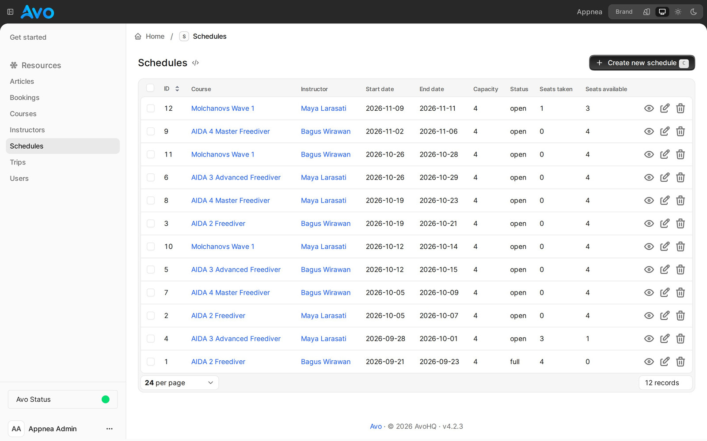

Jadwal menghubungkan kursus dengan tanggal dan instruktur.

| Kolom | Keterangan |
|---|---|
| Course | Kursus yang diajarkan |
| Instructor | Boleh dikosongkan kalau belum ditentukan |
| Start date / End date | Tanggal mulai dan selesai |
| Capacity | Jumlah kursi |
| Status | Open, Full, Cancelled, atau Done |
| Seats taken | **Hanya bisa dibaca**, tidak bisa diedit |

> **Kenapa Seats taken tidak bisa diedit?** Angka itu dikelola otomatis oleh
> sistem booking, yang mengunci baris database saat mengubahnya supaya dua
> booking bersamaan tidak bisa menembus kapasitas. Kalau angkanya bisa diketik
> manual di sini, pengaman itu jadi percuma dan angkanya bisa tidak cocok dengan
> jumlah booking yang sebenarnya.
>
> Kalau kamu perlu menambah kapasitas, ubah kolom **Capacity**, bukan Seats
> taken.

Mengubah status jadi **Cancelled** membuat jadwal itu hilang dari website dan
tidak bisa di-booking lagi. Booking yang sudah ada tidak ikut terbatalkan
otomatis — batalkan satu per satu dari daftar Booking.

## 3.7 Mengelola booking

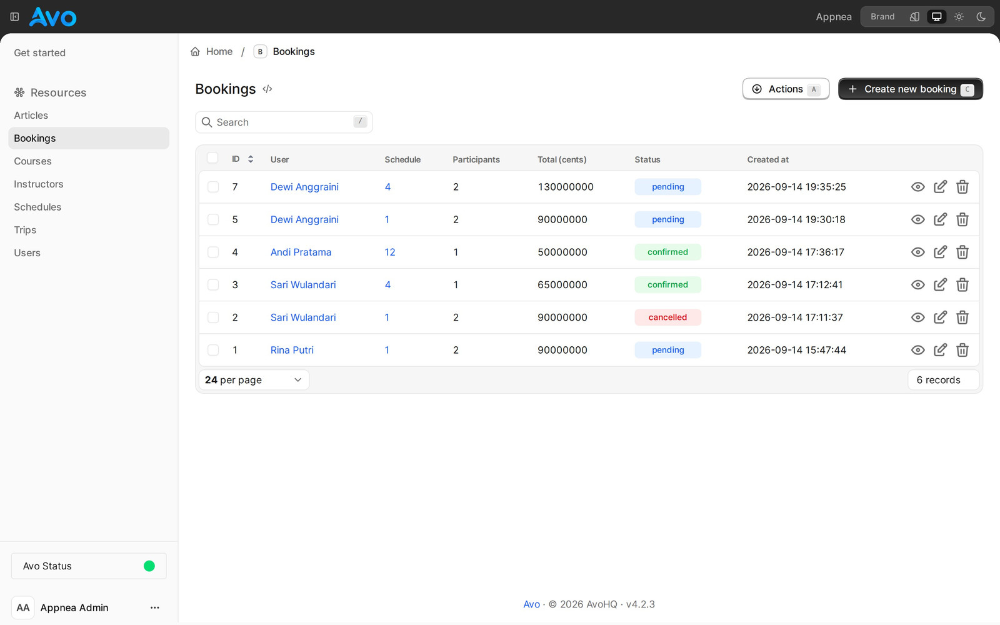

Daftar semua booking beserta statusnya.

Klik salah satu untuk melihat detailnya.

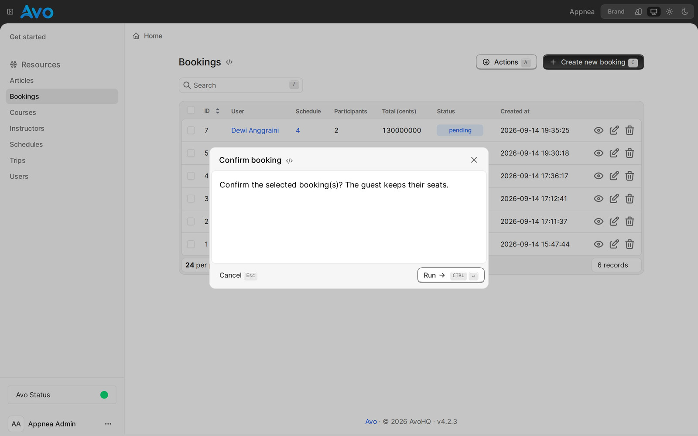

Semua kolom di sini **hanya bisa dibaca**. Untuk mengubah status, pakai dua
tombol aksi di kanan atas:

### Confirm booking

Mengubah status jadi **Confirmed** dan **mengirim email konfirmasi** ke murid.

Kursinya sendiri sudah tertahan sejak booking dibuat, jadi mengonfirmasi tidak
mengubah jumlah kursi.

### Cancel booking

Mengubah status jadi **Cancelled** dan **mengembalikan kursinya** ke jadwal.

Kalau jadwal tadinya sudah penuh, statusnya otomatis kembali jadi **Open**.

> **Kenapa harus lewat tombol aksi, bukan diedit langsung?** Karena mengubah
> status booking harus dibarengi dengan menambah atau mengurangi kursi di
> jadwal. Kalau statusnya bisa diketik manual, kursinya tidak ikut berubah dan
> datanya jadi kacau.

Kamu bisa memilih beberapa booking sekaligus lewat kotak centang, lalu
menjalankan aksi untuk semuanya sekaligus.

## 3.8 Mengelola instruktur

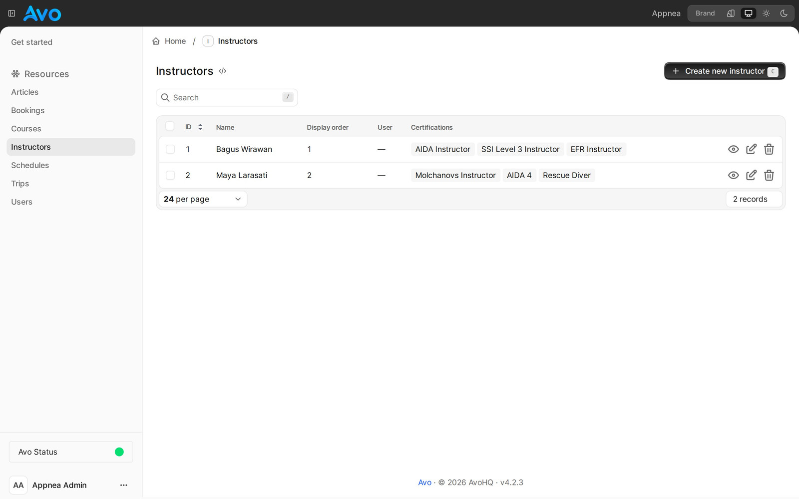

| Kolom | Keterangan |
|---|---|
| Name | Nama instruktur |
| Display order | Angka kecil tampil lebih dulu di website |
| User | Akun login, **boleh dikosongkan** |
| Certifications | Daftar sertifikasi, ketik lalu Enter untuk tiap item |
| Bio | Profil singkat |
| Photo | Foto |

> **Kolom User boleh kosong.** Profil instruktur bisa ada tanpa orangnya punya
> akun login. Isi kolom ini hanya kalau instrukturnya memang perlu masuk ke
> sistem.

## 3.9 Mengelola artikel

Sama seperti kursus, tapi yang menentukan tampil atau tidaknya adalah kolom
**Published at**:

- **Dikosongkan** — artikel berstatus draf, tidak muncul di mana pun
- **Diisi tanggal lampau** — artikel tampil
- **Diisi tanggal mendatang** — artikel belum tampil sampai waktunya tiba

Ini berguna untuk menjadwalkan tulisan.

---

# Bagian 4 — Email

Sistem mengirim dua jenis email ke murid:

| Email | Kapan dikirim | Isinya |
|---|---|---|
| **Booking received** | Begitu murid melakukan booking | Rincian booking, penegasan bahwa belum ada tagihan |
| **Booking confirmed** | Saat admin menekan Confirm | Tanggal, nama instruktur, dan apa yang perlu dibawa |

**Saat development, email tidak benar-benar dikirim.** Semuanya ditulis sebagai
file ke `backend/tmp/mails/`. Untuk membacanya:

```bash
cat backend/tmp/mails/*
```

> **Email masih berbahasa Inggris.** Walaupun website sudah dua bahasa, isi
> emailnya belum mengikuti pilihan bahasa murid.

---

# Bagian 5 — Pertanyaan yang Sering Muncul

**Kursus yang saya buat tidak muncul di website.**
Cek kolom **Published**. Kalau belum dicentang, kursus sengaja disembunyikan.

**Jadwal tidak muncul di halaman kursus.**
Tiga kemungkinan: tanggalnya sudah lewat, statusnya bukan **Open**, atau kursus
induknya belum Published. Website hanya menampilkan jadwal mendatang yang masih
terbuka dari kursus yang sudah terbit.

**Angka sisa kursi terlihat aneh.**
Cek daftar Booking untuk jadwal itu. Jumlah peserta dari booking yang berstatus
Pending dan Confirmed seharusnya sama dengan angka Seats taken. Kalau tidak
cocok, kemungkinan ada yang mengubah data langsung di database, bukan lewat
aplikasi.

**Saya mau menaikkan kapasitas jadwal yang sudah penuh.**
Ubah kolom **Capacity**, lalu ubah **Status** dari Full kembali ke Open.

**Gambar yang saya unggah tidak muncul.**
Pastikan `libvips` terpasang di server. Tanpa itu, gambar tersimpan tapi
ukuran-ukurannya gagal dibuat. Cek dengan `vips --version`.

**Ada murid minta dihapus datanya.**
Batalkan dulu semua booking-nya lewat tombol Cancel booking supaya kursinya
kembali, baru hapus akunnya dari daftar User.

**Bagaimana cara menambah bahasa ketiga?**
Perlu perubahan kode, tapi tidak perlu mengubah struktur database. Kolom
Translations sudah berbentuk JSON yang bisa menampung banyak bahasa.

**Kapan pembayaran online tersedia?**
Belum dijadwalkan. Struktur datanya sudah disiapkan, jadi menambahkannya nanti
adalah pekerjaan integrasi, bukan perombakan.

---

# Bagian 6 — Tampilan di Ponsel

Website menyesuaikan diri dengan layar kecil.

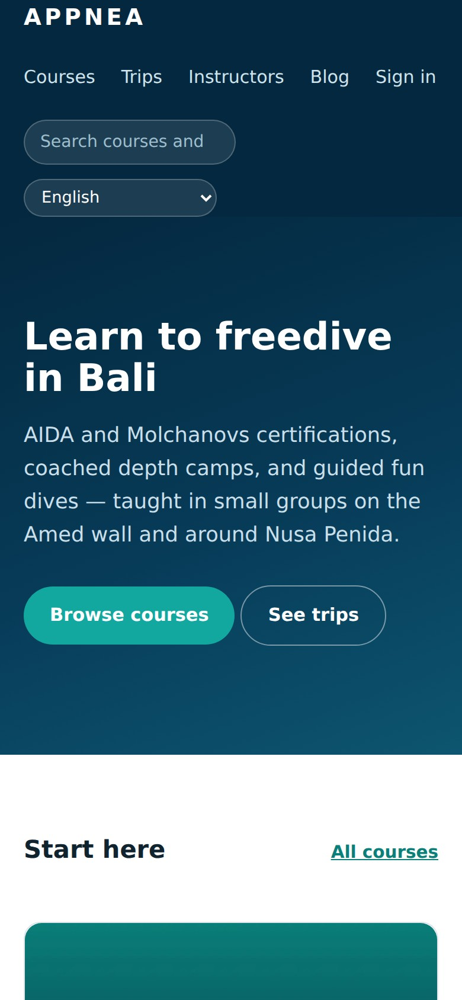

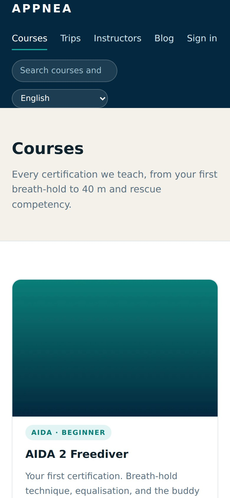

Menu, kotak pencarian, dan pemilih bahasa turun ke baris berikutnya, dan kartu
kursus menumpuk jadi satu kolom.

Panel admin juga bisa dibuka dari ponsel, tapi lebih nyaman dikerjakan dari
layar besar.
